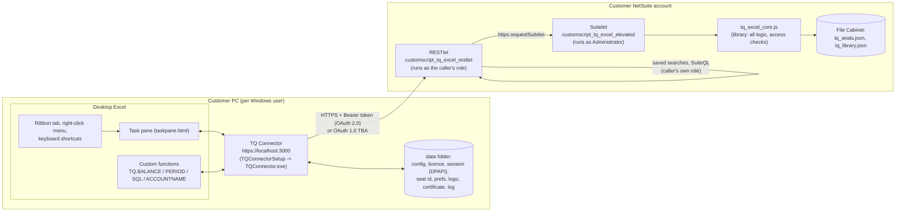
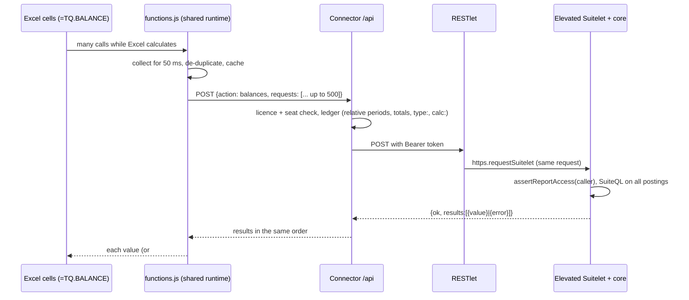
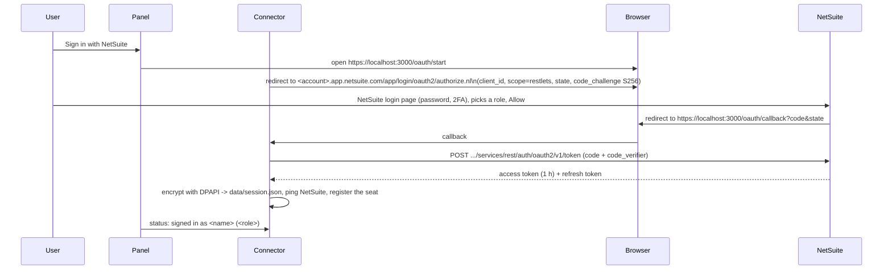

# TQ Connector for NetSuite: Technical Reference

Internal document for Techno Q: how the product is built, what runs where, every script, package, file, setting
and security decision. For installing at a customer see the installation guide; for end users see the user
guide.

| Part | Version (Nov 2026) |
|---|---|
| Connector (TQConnector.exe, `server/server.py` `VERSION`) | 1.5.3 |
| Excel add-in (`addin/manifest.xml` `<Version>`) | 1.5.3.0 |
| NetSuite script (`netsuite/tq_excel_core.js` `VERSION`) | 8 |
| NetSuite package (SuiteCloud SDF project, `netsuite/sdf`) | deployed to Techno Q 12253116 and the sandbox 65987_SB1 |
| NetSuite bundle (what customers install) | **715956** "TQ Excel Connector", in Techno Q's account 12253116 |
| Sign-in integration (shared by every customer) | "TQ Excel Connector" in 12253116, Client ID `028fcb4f...b34f` (`DEFAULT_CLIENT_ID`) |
| Source | private GitHub repository `TechnoQ-QA/TQ-EXCEL-Connector`, branch `main` |
| Tests | 98 (`python -m unittest discover -s tests`) |

---

## 1. What the product is

An Excel add-in, sold by Techno Q, that brings live NetSuite general ledger figures into desktop Excel, in the
style of Solution 7: formulas such as `=TQ.BALANCE("4000","Oct 2026")`, ready-made and custom financial reports
that roll forward with one month cell, dashboards, drill down to transactions, budget and journal upload, data
tables from any NetSuite record, a chat that builds reports from plain words, and PDF and values packs.

Design rules that shaped every decision:

- **Desktop Excel only** (Windows). No web or Mac version.
- **Free and self-contained.** No Techno Q cloud service, no paid third-party service. Everything runs on the
  customer's PC and in the customer's NetSuite. The AI part is an optional add-on that only works with the
  customer's own API key.
- **NetSuite's own security decides what a user sees.** Each person signs in with their own NetSuite login.
- **No secrets leave the PC.** Passwords never reach the connector; tokens are encrypted per Windows user.

---

## 2. Architecture



Why a local connector at all:

1. Office add-ins must be served over **HTTPS**. The connector serves the add-in's pages and scripts from
   `https://localhost:3000` with a certificate made for that PC.
2. NetSuite tokens must be kept somewhere safe. The connector keeps them encrypted for the Windows user
   (DPAPI) and adds them to each call, so the browser part of the add-in never holds a token.
3. The report engine (layouts, templates, dashboards, the chat, budget and journal checks) is Python on the PC,
   so nothing depends on a Techno Q server.

Because Excel loads the add-in **from the connector**, the connector must be running for the add-in to load.
Since 1.4 it is started with `--watch` and restarted automatically if it stops (section 6.10).

### 2.1 How a balance formula is answered



The RESTlet runs with the caller's role. A role that cannot see some transaction types would get understated
balances, so balances go to the **elevated Suitelet**, which runs as Administrator and sees every posting.
Before answering it checks that the caller may run financial reports (section 4.4).

Data queries (saved searches and SuiteQL for the Data tables screen and `TQ.SQL`) do **not** go to the Suitelet:
the RESTlet runs them itself as the caller's role, so each user sees exactly the records their role allows.

### 2.2 Sign-in (OAuth 2.0 authorization code with PKCE)



The integration is a **public client**: there is no client secret on the PC; PKCE proves the code was asked for
by this connector. The connector renews the access token two minutes before it ends, and retries once on a 401.
When the refresh token ends (its lifetime is set on the integration record, up to 30 days) the user signs in
again. Sign out revokes the refresh token at NetSuite and empties `session.json`.

The older **token-based authentication** (OAuth 1.0, HMAC-SHA256 header from four keys in `config.json`) still
works for accounts not moved yet. NetSuite retires TBA by 2027.

---

## 3. Repository layout

| Path | What it holds |
|---|---|
| `addin/` | The Excel add-in: manifest, pages, scripts, styles, icons, keyboard shortcuts |
| `server/` | The connector (Python 3.12, standard library only) |
| `netsuite/` | The three NetSuite scripts (the source of truth) |
| `netsuite/sdf/` | The SuiteCloud package: copies of the scripts plus object XML (script records, deployments, role) |
| `installer/` | Inno Setup script, build script, signing script, Techno Q's public certificate, legacy PowerShell installer |
| `scripts/` | Techno Q tools: licences, update signing, NetSuite package, icons, connection check, developer setup |
| `tests/` | `test_server.py`: 98 tests (server, reports, layouts, templates, sign-in, seats, updates, package, care) |
| `docs/` | This document, the client IT install note, the panel mockup |
| `build/` | Build output (not in Git): venv, PyInstaller output, staged app, setup file, checksum, certificate |

Not in Git (`.gitignore`): `server/config.json`, `server/licence.json`, `server/machine.json`,
`server/prefs.json`, `server/data/`, `data/`, `certs/`, `build/`, `netsuite/sdf/project.json`, `*.pfx`, `*.key`,
`.claude/`, `__pycache__/`.

---

## 4. NetSuite side

### 4.1 Scripts

| File | Type | Script ID | Deployment ID | Runs as | Purpose |
|---|---|---|---|---|---|
| `tq_excel_restlet.js` | RESTlet 2.1 | `customscript_tq_excel_restlet` | `customdeploy_tq_excel_restlet` | the caller's role; released; all roles | What the connector calls. Runs data queries itself; hands everything else to the Suitelet. |
| `tq_excel_elevated.js` | Suitelet 2.1 | `customscript_tq_excel_elevated` | `customdeploy_tq_excel_elevated` | **Administrator**; not available without login; all roles | Runs `tq_excel_core.handle()` so balances see every posting. |
| `tq_excel_core.js` | library (2.1) | (file only) | | (inside the Suitelet) | All logic: balances, lists, budgets, journals, seats, branding, library, access checks. |

All three live in `SuiteScripts/TQ Excel Connector/` in the File Cabinet.

### 4.2 Actions

Answered by **tq_excel_core.js** (through the Suitelet):

| Action | What it does | Since |
|---|---|---|
| `ping` | Version, account, user name, role: the connection test | 1 |
| `setup` | Version, OneWorld on/off, multi-currency on/off | 1 |
| `balances` | Many balance requests in one call (account, periods, subsidiary, department, class, location, filters, budget, book, currency) | 1 |
| `transactions` | Transaction lines behind one balance (drill down), with a NetSuite link per transaction | 1 |
| `accounts` | Chart of accounts (number, name, type); accounts without a number are `ID<internal id>` | 1 |
| `periods` | Accounting periods (name, start, end) | 1 |
| `segments` | Values of a segment (subsidiary, department, class, location, custom segments, book, currency) | 1 |
| `filterFields` | Fields a report can filter on: segments, Name, Item, custom segments, Book (multi-book), Currency | 2 |
| `budgetInfo` / `budgetSave` | Budget years, categories and permission; writes budget lines (dry run first) | 3 |
| `journalSave` | Checks or creates journal entries (balanced, open period, known accounts) | 4 |
| `seat` | Registers a seat for the caller (per user with sign-in, per PC with tokens); refuses when full | 4 / 6 |
| `branding` | Company or subsidiary name and logo (Company Information) for PDF headers | 5 |
| `seatList` / `seatRelease` | Who holds a seat; release (own seat, or any for an administrator) | 6 |
| `libraryList` / `librarySave` / `libraryLoad` / `libraryDelete` | The company report library | 7 |

Answered by the **RESTlet itself**, as the caller's role: `searchList` (saved searches the caller can see),
`searchRun` (run one, up to 20,000 rows), `sql` (a SuiteQL SELECT with ? parameters), `tableColumns` (fields of a
record for the query builder).

Script version history: 1 balances and lists; 2 filters (several values, "not", "Name*" for children, custom
segments, Name, Item) and consolidation in multi-currency OneWorld; 3 budgets; 4 statistical accounts, Book and
Currency, journals, seats; 5 branding; 6 seats per NetSuite user, seat list and release; 7 report library.

### 4.3 Calculation rules

- Balances are returned in their natural sign: income, liabilities and equity positive, as on NetSuite reports.
- Profit and loss accounts: the sum of the periods asked for. Balance sheet accounts: cumulative to the end of the
  last period.
- Account arguments: `4000`, `4000-4999`, lists `4000, 4100`, `type:Income`, `type:Bank,AcctRec`,
  `calc:NetIncome`, `calc:NetIncomeYTD`, `calc:RetainedEarnings`, `calc:Days`, `move:` (movement of balance
  sheet accounts, for the cash flow), `budget:` / `budget(Category):` for budgets.
- Segment arguments: `Sales`, `Sales, Bar`, `not Sales`, `Food*` (with everything under it), `Parent*` or
  `Parent (consolidated)` for a consolidated subsidiary.
- Other filters: `Brand: Premium, Basic; Name: Al Noor; Department: Rooms*; Item: X`.
- Consolidation (OneWorld, several currencies): BUILTIN.CONSOLIDATE with NetSuite's consolidated exchange rates;
  P&L at each period's rate, balance sheet at the report period's rate, as NetSuite does.
- Statistical accounts (type Stat) return units, not money, and are never translated.

### 4.4 Who may do what

| Check | Rule (in `tq_excel_core.js`) |
|---|---|
| Any balance or list (`assertReportAccess`) | The caller has the Administrator role, or a role with REPO_FINANCIALS, REPO_TRIALBALANCE or REPO_GL. Otherwise: "None of your NetSuite roles may run financial reports". |
| Budget upload | Administrator, or ADMI_BUDGET / LIST_BUDGET / TRAN_BUDGET / ADMI_SETUPBUDGET at Edit or higher |
| Journal upload | Administrator, or TRAN_JOURNAL at Edit or higher |
| Release someone else's seat; replace or remove someone else's library layout | Administrator |
| Data queries | Whatever the caller's own role can see (NetSuite enforces it) |

The role checks read role tables that only Administrator can read, which is why the Suitelet must run as
Administrator. If it does not, the error says "Deploy the elevated Suitelet with Execute As Role = Administrator".

### 4.5 Files the script writes in the File Cabinet

All sit in the same folder as `tq_excel_core.js` and are created on first use.

| File | Content |
|---|---|
| `tq_seats.json` | `{machines: {key: {label, user, last}}}`; key `u<employee id>` with sign-in, else the PC's id. A seat not used for 30 days is free; entries older than 120 days are removed. Written at most twice a day per seat. |
| `tq_library.json` | `{items: {id: {name, description, design, by, byId, at}}}`; id is the name in lower case with dashes. Up to 200,000 characters per layout. |
| `tq_licence.json` | The licence exactly as Techno Q issued it (customer, account, users, expires, issued, signature), written by `licenceSave` (administrator only, account must match). Since script version 8. |

### 4.6 The SDF package (`netsuite/sdf`)

| File | Content |
|---|---|
| `src/manifest.xml` | Project "TQ Excel Connector", ACCOUNTCUSTOMIZATION; features: SERVERSIDESCRIPTING (required), SUBSIDIARIES and CRM (optional) |
| `src/deploy.xml` | Deploys `FileCabinet/SuiteScripts/TQ Excel Connector/*` and `Objects/*` |
| `src/Objects/customscript_tq_excel_restlet.xml` | RESTlet record and deployment (released, all roles, log level ERROR) |
| `src/Objects/customscript_tq_excel_elevated.xml` | Suitelet record and deployment (run as ADMINISTRATOR, released, all roles, not online, log level ERROR) |
| `src/Objects/customrole_tq_excel_user.xml` | Role **TQ Excel User** (below) |
| `suitecloud.config.js` | Default project folder `src` |
| `project.json` | The CLI's authentication ID for an account (local only, not in Git) |

Role **TQ Excel User** permissions:

| Permission | Level |
|---|---|
| REPO_FINANCIALS (financial statements) | View |
| REPO_TRIALBALANCE | View |
| REPO_GL (general ledger) | View |
| ADMI_LOGIN_OAUTH (log in using access tokens) | Full |
| ADMI_LOGIN_OAUTH2 (log in using OAuth 2.0) | Full |
| LIST_ACCOUNT | View |
| LIST_FIND (perform search) | View |
| TRAN_FIND (find transaction) | View |
| LIST_CUSTJOB, LIST_VENDOR, LIST_ITEM | View |

Workflow (Techno Q):

```
python scripts/package_netsuite.py     # copies netsuite/*.js into the package and checks every object
cd netsuite/sdf
suitecloud account:setup                # once per account (browser sign-in); auth ID e.g. tq-sandbox
suitecloud project:validate --server
suitecloud project:deploy
```

Always edit the scripts in `netsuite/`, never the copies in `netsuite/sdf/src/...`; the package script and a test
check that they are identical. Tools on the deploying PC: Node.js 22 LTS, Oracle JDK 17 or 21, SuiteCloud CLI
(`npm install -g @oracle/suitecloud-cli`, 4.1.1 used). The two warnings the deploy prints ("allroles only selects
internal roles") are expected.

Deploy history on the sandbox 65987_SB1: first deploy (29/29 steps, existing hand-made scripts updated in place),
version 6 (19 Nov 2026), version 7 (19 Nov 2026, library saved, read and removed live). A stray older
`tq_excel_restlet.js` directly in SuiteScripts (file 14736) is unused and can be deleted.

### 4.7 NetSuite setup at a customer (since 1.5)

Per account, by the customer's administrator, about 10 minutes:

1. **Enable features** (Setup > Company > Enable Features > SuiteCloud): Server SuiteScript and OAuth 2.0 (both
   usually on already).
2. **Install bundle 715956** (Customization > SuiteBundler > Search & Install Bundles). It brings the two scripts and
   their deployments, the role TQ Excel User and the sign-in integration.
3. **Roles**: give each Excel user TQ Excel User next to their own roles.

Nothing is copied by hand any more:

| Before 1.5 | Since 1.5 |
|---|---|
| Integration record per customer, Client ID copied to every PC | One integration owned by Techno Q (12253116), public client, built into the connector as `DEFAULT_CLIENT_ID`. NetSuite installs it in the customer's account at the first sign-in (proven against 65987_SB1), and the bundle carries it too. `clientId` in `config.json` still overrides it. |
| RESTlet External URL copied | `restlet_url(account)`: `https://<account, lower case, _ as ->.restlets.api.netsuite.com/app/site/hosting/restlet.nl?script=customscript_tq_excel_restlet&deploy=customdeploy_tq_excel_restlet` (script IDs work in place of numbers) |
| Fiscal year start typed | The `setup` action returns `fiscalStartMonth` (start month of the latest accounting period with `isyear='T'`); the connector reads it in the background when `fiscalYearStartMonth` is not set |
| `licence.json` copied to every PC | Stored once in NetSuite (`tq_licence.json`, 4.5). Actions `licenceGet` (any user) and `licenceSave` (administrator only). The connector asks for it after sign-in and on status checks (at most once a minute), verifies signature and account, and writes `data\licence.json`. A licence chosen in the installer or pasted on the setup page is pushed to NetSuite when the user is an administrator. A PC that is already licensed compares its copy with NetSuite's at start-up and every 6 hours: it stores its own when NetSuite has none, and takes NetSuite's when that one is newer (later `issued`, then later `expires`), so a renewal reaches every PC within 6 hours. |

Integration settings (12253116): Authorization Code Grant, Public Client, scope RESTlets, redirect
`https://localhost:3000/oauth/callback`, refresh token validity and rotation 720 hours. Its client secret is not used
and must not be shared. The old sandbox integration (65987_SB1, record 110) is no longer needed.

### 4.8 The SuiteBundle (715956)

Built with SuiteBundler in Techno Q's account 12253116 (Customization > SuiteBundler > Create Bundle), from the
objects that the SDF package deployed there:

| Component | Id | Lock |
|---|---|---|
| File `SuiteScripts/TQ Excel Connector/tq_excel_restlet.js` | 633 | locked, **hidden in SuiteBundle** |
| File `SuiteScripts/TQ Excel Connector/tq_excel_elevated.js` | 632 | locked, **hidden in SuiteBundle** |
| Script `customscript_tq_excel_restlet` (RESTlet, with deployment) | 319 | locked, update deployments |
| Script `customscript_tq_excel_elevated` (Suitelet, run as Administrator) | 318 | locked, update deployments |
| Integration "TQ Excel Connector" | 2 | locked |
| Role `customrole_tq_excel_user` | 1100 | not locked (customers may add permissions) |

- SuiteBundler does not follow SuiteScript 2 `define()` imports, so `tq_excel_core.js` would be missing at the
  customer. `scripts/package_netsuite.py` therefore writes the Suitelet **with the library inside it**
  (`combined()`): `define(<core deps>, (<core params>) => { const connector = (() => { <core body> })(); <Suitelet
  body> });`. The RESTlet needs no library. Edit `netsuite/tq_excel_core.js` and `netsuite/tq_excel_elevated.js`;
  the package script and a test check the combined copy.
- Availability: **Public** (since 22 Nov 2026): any NetSuite account installs it by ID 715956; the licence controls
  use. Changed on Customization > SuiteBundler > Create Bundle > List > Set Availability.
- Releasing a new script version: deploy the SDF package to 12253116 (auth ID `tq-publisher`), then Customization >
  SuiteBundler > Create Bundle > List > 715956 > **Push** to the customer accounts (or customers update from
  Installed Bundles).
- NetSuite now recommends Copy to Account or SDF over SuiteBundler; SuiteBundler is still supported and is the only
  route for installing by ID without a CLI at the customer.

SuiteCloud CLI authentication IDs on the Techno Q PC (`netsuite/sdf/project.json` `defaultAuthId`): `tq-publisher`
(12253116, Administrator) and `tq-sandbox` (65987_SB1).

---

## 5. The Excel add-in (`addin/`)

### 5.1 Manifest

| Item | Value |
|---|---|
| Id | `6f1c2a9e-3b7d-4e58-9a41-c2d07b5e8f13` |
| Type / host | TaskPaneApp, Workbook |
| Requirement | SharedRuntime 1.1 (task pane, custom functions and ribbon commands share one JavaScript runtime) |
| Permissions | ReadWriteDocument |
| Source | `https://localhost:3000/taskpane.html` |
| Custom functions | `functions.js`, metadata `functions.json`, namespace `TQ` |
| Icons | `assets/*.png` with `?v=112` (raise the tag when icons change: Excel caches icons) |
| Keyboard shortcuts | `ExtendedOverrides` -> `https://localhost:3000/shortcuts.json` |
| Registration | Per user: `HKCU\Software\Microsoft\Office\16.0\WEF\Developer\<Id>` = path of `manifest.xml` (set by the installer) |

Ribbon: a **TQ Connector** button on the Home tab (group NetSuite), and a **TQ Connector** tab:

| Group | Button | Action (Office.actions id) |
|---|---|---|
| Reports | Open panel | show task pane |
| | New report | `newReport` |
| | Dashboard | `newDashboard` |
| | Chat | `openChat` |
| Refresh | Refresh all / Refresh sheet / Refresh selection | `refreshAll` / `refreshSheet` / `refreshSelection` |
| Explore | Drill down / Insert formula | `drillDown` / `insertFormula` |
| Send | Copy as values / Set up for PDF | `copyValues` / `setupPdf` |

Right-click menu on cells (`ContextMenuCell`): TQ Connector > Drill down, Refresh selection, Refresh sheet,
Insert formula.

Keyboard shortcuts (`shortcuts.json`): Ctrl+Alt+Shift+D drill down, +R refresh sheet, +A refresh all,
+S refresh selection, +N new report, +T show the panel (`showPanel`). Excel asks the user if another add-in uses
the same keys.

### 5.2 Custom functions

| Function | Arguments | Notes |
|---|---|---|
| `TQ.BALANCE` | account, fromPeriod, [toPeriod], [subsidiary], [department], [class], [location], [filters] | Batched (50 ms window, up to 500 per request), de-duplicated, cached until a refresh. Errors per cell. |
| `TQ.ACCOUNTNAME` | account | From the cached chart of accounts |
| `TQ.PERIOD` | period, [shift] | Period name worked out from another: months (-1, 12) or CM, LY, FYS, FYE, QS, QE with +n/-n |
| `TQ.LIST` | kind, [filter], [fromPeriod], [toPeriod], [hideZero], [subsidiary], [show] | Spills (matrix result). Action `list` (`ledger.list_rows`): accounts [number, name] (show: number/name), segments and periods [name]; filter = account list (`4000-4999`, `type:Expense`) or a name pattern (`Food*`); hideZero keeps accounts with a balance in the periods, segments with a P&L balance; periods are months only. Up to 2,000 rows; cached until a refresh. |
| `TQ.SQL` | query, [p1]..[p4] | First value of a SuiteQL query, run with the user's own role; `?` takes the parameters |

Relative periods anywhere a period is accepted: `CM` (current month), `CM-1`, `LY` (same month last year),
`FYS` / `FYE` (first / last month of the fiscal year), `QS`, `QE`, `FYS-12`. With a month cell:
`=TQ.PERIOD($B$8,"FYS")`.

`functions.js` also keeps, per cell address, the request behind each balance (for drill down), and counts
requests, answers and failures with their cells (for refresh progress and "refreshed at").

### 5.3 Files

| File | Role |
|---|---|
| `manifest.xml` | Add-in manifest (above) |
| `taskpane.html` | The panel: header, all screens, message line |
| `panel.css` | Styles; Office neutrals, Techno Q orange (#c2571a / dark #f08a45); light and dark themes |
| `nav.js` | Screen switching (`TQNav.go/back/replace`), Back, focus on the heading, settings menu, filter pills, Excel theme |
| `functions.js` | Custom functions, batching, cache, refresh statistics, `TQ.callApi` |
| `taskpane.js` | Status line, sign-in/out, update and script-version banners, refresh with progress, drill down, large drill window, lists, message line |
| `home.js` | Home, This report (follows the open sheet), welcome, report wizard, refreshed-at stamps, ribbon actions |
| `chat.js` | Chat screen; `applyActions` (writes the server's sheet actions into Excel), comments kept on rebuild, backups and restore |
| `designer.js` | Layout screen (lines, columns, options, highlight rules) |
| `filters.js` | Add a filter, filter chips, reading and writing the filter cells |
| `data.js` | Data tables (saved searches, SuiteQL, query builder, ready-made queries, parameters) |
| `builder.js` | Insert a formula |
| `pack.js` | Copy as values, set up for PDF (logo and company header), `placeLogo` on dashboards |
| `budget.js` | Budget and journal upload screen |
| `library.js` | Company library (save, list, use, remove) and the demo pack |
| `extras.js` | Saved filter sets, collect comments, help tips, sheet tour, quick search, move to another PC |
| `drill.html` | Large drill-down window (Office dialog): sort, search, totals, send to sheet via `messageParent` |
| `setup.html` / `setup.js` | Setup page: overview, connection, licence, logo, seats, updates, AI add-on, diagnostics, certificate date |
| `shortcuts.json` | Keyboard shortcuts |
| `functions.json` | Custom function metadata (descriptions shown in Excel) |
| `assets/` | Ribbon and add-in icons (`scripts/make_icons.py`), `tq.ico` |

### 5.4 What is stored in the workbook

| Where | What |
|---|---|
| Report sheets | A1 title; A2 a note (layout reports: `Built from layout sheet "..."`; dashboards: `Live from NetSuite...`); A3:B7 filters (Other filters, Subsidiary, Department, Class, Location); B8 the month (`Month`); E4:F7 optional dropdown filters; then the header and lines; optional Comments column at the right |
| `TQ Layout ...` sheets | One per layout: settings rows, the lines table and the columns table (5.5) |
| `TQ Queries` | The data table definitions and parameters |
| `TQ Backup ...` (hidden) | The previous version of each rebuilt report sheet (one per sheet) |
| `TQ Commentary` | Made by Collect comments |
| Document settings | `tqRefreshed` {SHEET: time} for "refreshed at"; `tqBackups` {sheet: {backup, at}} |
| Browser storage (per PC) | `tq.welcomed` (welcome shown), `tq.theme` (theme for the setup page) |

### 5.5 Layout sheet format

Settings rows (column A name, column B value): Report title, Subsidiary / Department / Class / Location filter,
Other filters, Dropdown filters, One sheet per (location, department, class, subsidiary), Show accounts,
Report month, Highlight changes over, Comments column, **Comment needed over**, Highlight rules, **Check line** (1.5.3,
default yes).

**% of a line (1.5.3).** A line whose Format has the word `base` is the base for the lines below it (until the next
`base`); a column formula `[Month@base]` takes that column on the base line, `[Month@Total Revenue]` on a named line.

**excluding (1.5.3).** An account list can leave accounts out: `type:COGS,Expense excluding 3000-3999`
(`ledger.members`).

**Check line (1.5.3).** The last row of a P&L or balance sheet report: per period column
`TQ.BALANCE(every account of that kind) - TQ.BALANCE(the lines' account lists)`, with the report's filters, red when not 0.
P&L layouts compare with `type:Income,OthIncome,COGS,Expense,OthExpense`, balance sheet layouts with the balance sheet
types in the chart. A new account that no line takes shows up there. Not added for layouts with `move:`/`budget:` lines (cash
flow), lines with their own filter (hotel), or `Check line: no` (`layouts.check_spec`).

Lines table: `Section | Line | Type | Accounts or formula | Sign | Format`.
- Type `accounts`: account numbers, ranges, `type:` groups, `calc:` totals. **A line can carry its own filter
  after a bar: `type:Income | Department: Rooms Division*`** (since 1.4; used by the hotel template).
- Type `subtotal`: the accounts lines above it in its section.
- Type `formula`: `=[Gross Profit]/[Sales]`, `days` for the number of days.
- Sign `-1` shows the amount negative. Format: percent, integer, bold, key.

Columns table: `Column | Column type | From | To | Subsidiary | Department | Class | Location | Other filters |
Column formula | Column format | Data`.
- `period` columns take From/To (names or relative: CM, CM+1, FYS, FYE, LY, FYS-12...).
- `formula` and `total` columns combine others: `=[Month]-[Month last year]`, `=SUM([Jan]:[Dec])`.
- Data `budget` or `budget(Category)` shows the budget instead of actuals.

Highlight rules: `6100 > 5000 red; Net Profit < 0 red; all between -100 and 100 yellow; 4000-4999 in Month <
10000 amber` (colours red, yellow, amber, green, blue, grey).

---

## 6. The connector (`server/`)

### 6.1 Runtime and packaging

- Python 3.12, standard library only (TLS, HTTP server, RSA, DPAPI through ctypes). No third-party packages at run
  time.
- Packaged with PyInstaller 6.11.1 (`--onedir --noconsole --noupx`, version resource "Techno Q / TQ Connector for
  NetSuite"), in `build\venv` only, so the build PC's Python is not changed.
- Installed per Windows user in `%LOCALAPPDATA%\TQ Connector`: `TQConnector.exe`, `_internal\`, `addin\`,
  `VERSION.txt`, `data\`.

### 6.2 Data folder (`%LOCALAPPDATA%\TQ Connector\data`)

| File | Content | Secret? |
|---|---|---|
| `config.json` | Connection settings (6.6) | contains secrets only with TBA or the AI key |
| `licence.json` | The signed licence | no (signed, account-bound) |
| `session.json` | OAuth tokens, **encrypted with DPAPI** for this Windows user | yes (unreadable elsewhere) |
| `machine.json` | This PC's id and name (for per-PC seats) | no |
| `prefs.json` | Saved filter sets | no |
| `logo.png` / `logo.jpg` | Uploaded logo (replaces the NetSuite logo) | no |
| `certs\localhost.crt`, `.key` | This PC's HTTPS certificate and its private key | key: yes |
| `certs\localhost.crt.sha1` | The certificate's thumbprint (for exact removal) | no |
| `certs\localhost.crt.trusted` | Marker: trusted for this user | no |
| `server.log` | Start-up, errors, restarts | no |

The installer and updates keep this folder; uninstall keeps it too.

### 6.3 Command line

| Option | Meaning |
|---|---|
| (none) | Run the connector on port 3000 (HTTPS) |
| `--watch` | Run the connector as a child process and restart it whenever it stops (used by the shortcuts and installer) |
| `--port N` | Another port (development) |
| `--mock` | Sample data, even with a config |
| `--http` | Plain HTTP (browser preview only; Excel needs HTTPS) |
| `--make-cert` | Make this PC's certificate and stop (used by the installer) |
| `--stop` | Ask the running connector and its watcher to stop: writes `data\stop`, which both check (every 0.5 s / when the child ends), waits until port 3000 no longer answers, removes the file. Exit 0 = stopped or not running, 1 = still answering after 15 s. Used by the installer since 1.5.1 |

### 6.4 HTTP endpoints

GET:

| Path | Returns |
|---|---|
| `/api/status` | mode (netsuite / sample), version, licence, seats, update, sign-in, chat and AI state |
| `/api/setup` | Settings without secrets, sign-in, logo source, licence, data folder, certificate expiry |
| `/api/update` | Checks the update address: available, version, notes |
| `/api/prefs` | Saved filter sets |
| `/logo` | Uploaded logo, else NetSuite's (cached), else 404 |
| `/oauth/start`, `/oauth/callback` | Sign-in redirect and return |
| any other path | Static files of `addin/` (`/assets/` cacheable for a week, everything else `no-store`) |

POST (JSON only):

| Path | Purpose |
|---|---|
| `/api` | NetSuite actions (4.2) and `period` (relative period names, worked out locally) |
| `/api/chat` | The chat: message -> reply and sheet actions |
| `/api/design` | Layouts and reports: `templates`, `new`, `wizard`, `dashboard`, `get`, `build`, `addLine`, `addColumn`, `removeLine/Column`, `moveLine/Column`, `setTitle`, `setPages`, `setDetail`, `setHighlight`, `addRule`, `removeRule`, `setComments`, `setCommentAt`, `setDropdowns`, `setFilters`, `libraryExport`, `libraryImport` |
| `/api/query` | Data tables (catalog, get, save, run, setParam, compose, searches) |
| `/api/budget` | Budget sheet info, check and upload |
| `/api/journal` | Journal check and upload |
| `/api/setup` | Save settings and licence, then reconnect and test |
| `/api/logo` | Upload (PNG/JPEG up to 1 MB) or remove the logo |
| `/api/signout` | Sign out (revoke and delete the session) |
| `/api/update` | Download, verify and run a signed update |
| `/api/prefs` | Save or remove a filter set |
| `/api/diagnostics` | Write the support zip (6.10) |
| `/api/export`, `/api/import` | Move to another PC (6.10) |

### 6.5 Local security

- Listens on **127.0.0.1 only**, port 3000.
- HTTPS with a certificate made on the PC (RSA, SHA-256, CN/SAN localhost, not a CA, 825 days), trusted for the
  Windows user only (`certutil -user -addstore Root`). Renewed 60 days before expiry (6.10).
- POST bodies must be `Content-Type: application/json` (exactly) and not marked cross-site
  (`Sec-Fetch-Site`), so other web pages cannot post to the connector. Bodies over 8 MB are refused.
- Secrets typed on the setup page are written to `config.json` and never sent back to a page.
- The licence and every update manifest are verified with Techno Q's public key before use.

### 6.6 Settings (`config.json`)

| Key | Meaning |
|---|---|
| `accountId` | NetSuite account, e.g. `1234567` or `1234567_SB1` |
| `restletUrl` | Optional: derived from `accountId` when empty (4.7) |
| `clientId` | Optional: Techno Q's shared integration when empty; TBA when the four TBA keys are given and no client ID |
| `consumerKey`, `consumerSecret`, `tokenId`, `tokenSecret` | TBA only (legacy) |
| `fiscalYearStartMonth` | Optional 1-12: read from NetSuite when empty |
| `updateUrl` | https address of `update.json` (optional) |
| `autoUpdateCheck` | `false` turns off the weekly update check |
| `ai` | `{apiKey, model}`: optional AI add-on with the customer's own key; default model `claude-opus-5-5` |

### 6.7 Server modules

| Module | Role |
|---|---|
| `server.py` | HTTP server, routes, configuration, NetSuite calls (Bearer or OAuth 1.0), sample-data backend, setup, logo, export/import, start-up |
| `signin.py` | OAuth 2.0 with PKCE, token refresh, revoke, DPAPI encryption |
| `ledger.py` | Cached view of NetSuite (accounts, periods, segments; 120 s), relative periods, totals and `type:/calc:/move:/budget:` expansion, drill URLs |
| `reports.py` | Standard reports (income statement, balance sheet, trial balance) and the report sheet frame |
| `layouts.py` | Layout sheets: parse, check, emit, build the report and its location sheets, highlights, comments, line filters |
| `templates.py` | Ready-made layouts: monthly P&L, management P&L, summary, balance sheet, cash flow, **hotel (USALI)**, **restaurant**, **rolling forecast**, **last 12 months**, and layouts read from a typed format |
| `dashboard.py`, `finance_dash.py` | Dashboards: executive, sales, cash, P&L, financial position, budget vs actual |
| `chat.py` | Plain-language commands, the wizard, the designer operations, library import/export |
| `queries.py` | Data tables, ready-made queries (receivables and payables aging, open invoices, purchases by vendor, purchase orders, sales by customer and item, stock on hand, budgets), query builder |
| `budget.py`, `journal.py` | Budget and journal sheets, checks, uploads |
| `licence.py`, `licence_key.py` | Licence parsing and verification; Techno Q's public key |
| `updates.py` | Seats (per user / per PC), update check, signed update install, weekly watcher |
| `care.py` | `--watch`, certificate renewal, diagnostics, filter-set preferences, export/import bundle |
| `assistant.py` | Optional AI add-on (customer's own key) |
| `tqcrypto.py` | RSA keys, PKCS#1 v1.5 SHA-256 signatures, self-signed certificate (pure Python) |

### 6.8 Licence

```json
{"customer": "World of Hospitality", "account": "1234567", "users": 5,
 "expires": "2027-12-31", "issued": "2026-11-17", "signature": "<base64>"}
```

- The signature (RSA 3072, PKCS#1 v1.5, SHA-256) covers the five fields, so a licence cannot be edited or moved to
  another NetSuite account. The account must match `accountId`.
- Made by Techno Q: `python scripts/make_licence.py --customer "..." --account 1234567 --users 5 --expires
  2027-12-31` -> `licence-<account>.json`.
- The private key is kept **outside the project**: `%USERPROFILE%\TQ Licence Key\private-key.json`. It also
  signs updates. Losing it means no new licences; a new key invalidates every licence issued. Keep an offline copy.
- Without a valid licence only the connection test reaches NetSuite. Sample data needs no licence.
- `users` is enforced by seats (6.9).
- **Expiry reminder (1.5.2).** From 30 days before `expires` (`licence.WARN_DAYS`), `check()` adds `daysLeft` and `warning`. The panel shows it as a yellow banner ("Hide for today", remembered in the browser; not hideable in the last 7 days); the setup page shows it on Overview and Licence. After the end date NetSuite data stops; a pasted renewal is picked up by every PC within about a minute.

**Making a licence (Techno Q only).** Licences are made on the Techno Q PC that holds the private key
(`%USERPROFILE%\TQ Licence Key\private-key.json`), with Python 3 and the project folder. Customers never run this.

1. Get from the customer: the company name to show, the NetSuite account ID (Setup > Company > Company
   Information > Account ID, e.g. `1234567`; a sandbox is `1234567_SB1`), the number of users and the last day
   of their subscription.
2. Open PowerShell in the project folder and run the command below. One licence fits one account: make a second
   one for the sandbox if they use it.
3. The script signs the licence, checks it against the connector's public key (`server/licence_key.py`) and writes
   `licence-<account>.json` in the project folder. Do not edit the file: any change breaks the signature. Do not
   commit it.
4. Send the file to the customer's administrator. They choose it on the setup's Licence page (or paste it later on
   Setup > Licence) and sign in; it is then stored in NetSuite and every other PC gets it at sign-in.

```powershell
cd C:\Users\<you>\Desktop\Development\netsuite-excel-connector
python scripts\make_licence.py --customer "Customer name" --account 1234567 --users 5 --expires 2027-12-31
```

- `--users` defaults to 5; `--out <file>` writes somewhere else. The issue date is today.
- **Renewal or more users:** run it again with the same account and the new users or date, and send the new
  file. The administrator pastes it on Setup > Licence; it replaces NetSuite's copy at once, and every other PC
  takes it within 6 hours (or at its next start).
- **Lost key:** without `private-key.json` no new licence can be made (and no update signed). `--new-key` makes
  a new pair but every licence already issued stops working, so keep an offline copy of the key file.

### 6.9 Seats

- With sign-in, a seat belongs to the **NetSuite user** (key `u<employee id>`), whichever PC they use. With TBA it
  belongs to the PC (`machine.json`).
- The connector registers the seat when it connects and re-checks every 6 hours (every 5 minutes while refused).
  `ping`, `seat`, `seatList` and `seatRelease` work without a seat; everything else is refused when the licence's
  users are all taken.
- A seat unused for 30 days frees itself. Setup page > Seats lists them; an administrator can release any.

### 6.10 Keeping it healthy and moving it (`care.py`, 1.4)

- **Watch.** `TQConnector.exe --watch` starts the connector as a child and restarts it when it stops (3 s after a
  long run; backing off up to 60 s after quick failures; if another copy already answers on the port it only
  checks once a minute). Tested: a stopped connector was back in about 26 seconds.
- **Certificate renewal.** At start-up, if the certificate expires within 60 days: make a new one beside it, run
  `certutil -user -addstore Root` (Windows asks the user), and only when that succeeds swap the files, mark it
  trusted and delete the old certificate by thumbprint. A "No" leaves the old one working and asks again at the
  next start.
- **Diagnostics.** `Documents\TQ Connector\TQ diagnostics <date>.zip` with `about.json` (versions, Windows,
  certificate expiry, data file names and sizes), `status.json`, `settings.json` (every key matching
  secret/token/password/key replaced by `***`) and the last 3,000 lines of `server.log`. Never `session.json`,
  the certificate key or the licence key.
- **Saved filter sets** in `data\prefs.json`: `{filterSets: [{name, cells: {subsidiary, department, class,
  location, filters}}]}`.
- **Move to another PC.** Export writes `Documents\TQ Connector\TQ setup <name> <date>.json`:
  `{kind: "tq-connector-setup", version: 1, connector, made, name, settings: {accountId, restletUrl, clientId,
  authMode, fiscalYearStartMonth, updateUrl, autoUpdateCheck}, licence, logo, filterSets, layouts, queries}`.
  No secret is ever included. Import applies what the user ticks: settings and licence through the normal save
  (validated, then reconnect), the logo, the filter sets; the panel rebuilds the layouts in the open workbook
  (`libraryImport`) and writes the TQ Queries sheet if the workbook has none.

### 6.11 Updates

- Techno Q publishes `update.json` at an https address the customer enters on the setup page:
  `{"version", "url", "sha256", "notes", "signature"}`, made by
  `python scripts/sign_update.py build/TQConnectorSetup.exe --version 1.4.0 --url https://.../TQConnectorSetup-1.4.0.exe --notes "..."`.
- The connector checks a minute after it starts and then weekly (unless `autoUpdateCheck` is false); the panel
  shows "Version X is available" with Install. Install downloads the setup file (up to 300 MB), checks its
  SHA-256 against the signed manifest, and runs it silently (`/VERYSILENT`); the setup keeps the settings and
  restarts the connector.
- **Not yet in use:** no update address is hosted. Until then updates are installed by running the new setup.

---

## 7. Reports, templates and screens

Report wizard (New report) choices:

| Group | Choices |
|---|---|
| Reports | Monthly P&L (month and YTD vs last year, rolls forward), P&L summary, P&L account by account, Budget against actual, Balance sheet (rolls forward), Cash flow, My own format (typed on a sheet) |
| Hospitality | **USALI P&L by Department** (`usali`, 1.5.3): per operated department (rooms, F&B, telecom, laundry, recreation/spa, parking, other, rental/misc; found by name like the hotel template) a `base` revenue line `type:Income | Department: X*`, payroll (Expense/COGS accounts whose name matches `templates.PAYROLL_RE`), other expenses `type:COGS,Expense excluding <payroll> | Department: X*`, departmental expenses and profit; Total Revenue (`base`), undistributed, GOP, non-operating, net profit, and a check against `calc:NetIncome`. Columns `usali_columns()`: Month, Month %, Budget, Budget %, Month last year, YTD, YTD %, YTD budget, YTD budget %, YTD last year, YTD last year %; `%` columns are `=[X]/[X@base]`. Show accounts on. **Hotel P&L (USALI summary)**: Rooms / F&B / other operated departments / miscellaneous revenue and departmental expenses and profit, undistributed expenses (A&G, IT, sales and marketing, maintenance, utilities, HR), GOP, GOP %, non-operating, net profit; occupancy, ADR and RevPAR from statistical accounts named like Rooms Available / Rooms Sold. Departments found by name among top-level departments (numbers in front such as "22 Food & Beverage" are ignored). **Restaurant P&L**: food and beverage sales and costs (accounts found by name), labour (salary, wage, payroll, staff, GOSI...), prime cost, food cost %, beverage cost %, labour %, prime cost %, operating margin. |
| Planning | **Rolling forecast**: actual to date + forecast rest of year (budget category matching forecast/outlook, else the budget) = full-year outlook vs full-year budget. **Last 12 months**: 12 rolling months and total. |
| Dashboards | Executive, Sales, Cash, Profit and loss, Financial position, Budget vs actual |
| Operational reports | Receivables aging, Payables aging, Open invoices, Sales by customer, Sales by item, Purchases by vendor, Stock on hand (data tables) |
| Company library | Layouts shared in NetSuite |

Every report the wizard makes is a layout, so it can be changed and rebuilt in place. Filters take several values
each. Options: one sheet per location / department / class / subsidiary (with a summary sheet), GL accounts under
each line, Comments column, highlight threshold, comment-needed threshold.

Panel screens: Welcome, Home (search, New report, tiles, reports in the workbook), New report, This report,
Add a filter, Layout (with Company library), Dashboards, Send / PDF, Upload, Formulas, Data tables, Drill down,
Chat, Keyboard shortcuts, Move to another PC. Header: logo, account and user, help (?), chat, settings menu.

---

## 8. Installer and build

### 8.1 Setup file (`installer/TQConnector.iss`, Inno Setup 6)

| Item | Value |
|---|---|
| AppId | `{A7C3E1D2-5B64-4F0A-9C21-7E8D3B9F4A10}` |
| Install | Per user, no administrator rights; `%LOCALAPPDATA%\TQ Connector` |
| Pages (first install only) | Welcome; **Connect to NetSuite** (account ID only; a pasted NetSuite address is reduced to the account); **Licence** (optional file, for the administrator's PC); skipped when a config exists or `TQConnector.settings.json` sits next to the setup file |
| Prepared roll-out | `TQConnector.settings.json` (a prepared config.json) and `licence.json` next to the setup file are copied in; no typing |
| Before copying | Stops the connector politely (`TQConnector.exe --stop`); then waits (up to 15 s) until no TQConnector.exe process is left, so no file is "in use" when it is replaced; only a connector older than 1.5.1, or a process still there after the wait, is closed with `taskkill /F` (antivirus behaviour monitors read a setup that kills processes as malware). A connector stopped this way ends its process at once (`os._exit`), since background threads would otherwise keep the exe and DLLs open; deletes the old program files (not `data\`); removes the old script installer's uninstall entry if it exists |
| Registry | `HKCU\Software\Microsoft\Office\16.0\WEF\Developer\6f1c2a9e-...` = `{app}\addin\manifest.xml` (removed on uninstall) |
| Shortcuts | Startup and Start menu "TQ Connector" -> `TQConnector.exe --watch` |
| After copying | Saves the entered settings; makes the certificate (`--make-cert`) if missing; trusts it (`certutil -user -addstore Root`, Windows asks); starts `--watch`; first install offers to open the setup page |
| Setup log | `%TEMP%\Setup Log <date> #NNN.txt` (`SetupLogging=yes`): which file failed and why |
| Uninstall | Stops the connector, removes the add-in registration, shortcuts, program files, and exactly this PC's certificate (by thumbprint); keeps `data\` |
| Silent | `TQConnectorSetup.exe /VERYSILENT /SUPPRESSMSGBOXES /NORESTART /ACCOUNT=1234567 [/LICENCE="path"]` (must run as the user, not SYSTEM) |

### 8.2 Build (`installer/build.ps1`)

```
powershell -ExecutionPolicy Bypass -File installer\build.ps1
```

1. Makes `build\venv` and installs PyInstaller 6.11.1 there (first time).
2. Runs the tests; stops if any fail.
3. Writes the version resource from `server.py` `VERSION`; builds `TQConnector.exe` (onedir, no console, no UPX).
4. Stages `build\stage\app` (exe, `_internal`, `addin`, `VERSION.txt`).
5. Signs `TQConnector.exe`; Inno Setup builds `build\TQConnectorSetup.exe` and signs it and its uninstaller.
6. Writes `build\TQConnectorSetup.exe.sha256.txt` and copies `TechnoQ.cer` to `build\`.

Inno Setup is installed per user (`%LOCALAPPDATA%\Programs\Inno Setup 6\ISCC.exe`;
`winget install --id JRSoftware.InnoSetup -e`). The repository path must not contain spaces (the signing command is
passed to Inno Setup as is).

### 8.3 Code signing

- **Techno Q's own certificate** (free, self-signed, code signing only): subject `CN=Techno Q Code Signing,
  O=Techno Q`, thumbprint `F264951F57972A7C749F4163724D4B2B2F2DD4AB`, RSA 3072, valid until 19 Nov 2031. Its
  private key is in the build PC's store (Current User > Personal), backed up as `TechnoQ-CodeSigning-backup.pfx`
  (password-protected; keep it offline, never in Git, never sent to clients).
- `installer/sign.ps1` signs with `Set-AuthenticodeSignature`, SHA-256, timestamp `http://timestamp.digicert.com`
  (falls back to no timestamp offline). `build.ps1` uses it automatically when the certificate is present.
- `installer/TechnoQ.cer` is the public certificate a client's IT trusts (Trusted Root + Trusted Publishers); see
  `docs/CLIENT-INSTALL.md`. On a PC that has not trusted it, the signature shows as not trusted (expected).
- A bought certificate later: set `TQ_SIGNTOOL` to its signing command with `$f`; `TQ_SIGNTOOL=none` builds unsigned.

### 8.4 Legacy

`installer/install.ps1`, `install.cmd` and `uninstall.ps1` are the earlier script-based installer, replaced by
Inno Setup; the setup removes its uninstall entry. `scripts/setup-excel.ps1` sets up a developer PC (certificate,
trust, add-in registration) to run the connector from source.

---

## 9. Development

```
python server/server.py --http --mock --port 3010     # browser preview with sample data
python server/server.py                               # HTTPS on 3000 with server/config.json (needs setup-excel.ps1 once)
python -m unittest discover -s tests                  # 98 tests
python scripts/check_netsuite.py --period "Oct 2026"  # connection check; prints balances, never credentials
python scripts/make_icons.py                          # regenerate icons
```

- In development the config and licence are `server/config.json` and `server/licence.json` (not in Git; never
  print their values).
- Edit NetSuite scripts in `netsuite/`, then `python scripts/package_netsuite.py` and deploy.
- Raise `VERSION` in `server.py` and `<Version>` in `manifest.xml` together; raise the `?v=` tags in
  `taskpane.html` when scripts change and in the manifest when icons change.
- Commits end with the co-author line; push to `origin main` (GitHub sign-in through Git Credential Manager).

---

## 10. Security summary

| Item | Where it lives | Leaves the PC? |
|---|---|---|
| NetSuite password | Typed only on NetSuite's own page | Never seen by the connector |
| OAuth tokens | `data\session.json`, DPAPI-encrypted per Windows user | Only to NetSuite, over HTTPS |
| TBA keys (legacy) | `config.json` | Only to NetSuite as an OAuth 1.0 signature |
| Integration client secret | Not used | Never |
| Licence private key | Techno Q PC, `%USERPROFILE%\TQ Licence Key` | Never |
| Code-signing private key | Techno Q build PC store + offline `.pfx` | Never |
| Localhost certificate key | `data\certs\localhost.key` | Never |
| AI key (optional) | `config.json` | Only to the AI provider, when the customer turned the add-on on |
| Diagnostics, setup export | Documents\TQ Connector | Only when the user sends the file; secrets removed |

---

## 11. Not verified yet and known limits

- Inside Excel after 1.4: hotel template on real departments, restore, collect comments, sheet tour, import on a
  second PC.
- A real journal posting (only the check has run).
- Book and currency (needs OneWorld or multi-book), room statistics (needs statistical accounts), a real forecast
  category.
- Installer pages and trusting `TechnoQ.cer` on a fresh PC.
- The update channel (no hosted address yet).
- Custom layouts read ledger balances only; other records come in as data tables.
- The built-in chat is a command reader; free-form questions and pictures need the optional AI add-on.

## 12. Troubleshooting

| Symptom | Cause and fix |
|---|---|
| Excel: "add-in error" / panel blank | The connector is not running: Start menu > TQ Connector (it then keeps itself running). Check `data\server.log`. |
| Panel: "TQ Connector is not running on this PC" | Same as above. |
| Certificate warning / add-in will not load after ~2 years | The certificate expired or was not trusted: restart the connector and answer Yes; or run the setup again. |
| "Not signed in" | Sign in with NetSuite (panel header or setup page). Refresh tokens last up to 30 days. |
| "None of your NetSuite roles may run financial reports" | Give the user TQ Excel User or a role with the report permissions. |
| "Deploy the elevated Suitelet with Execute As Role = Administrator" | Fix the Suitelet deployment (the package sets it). |
| Banner "NetSuite has TQ script version N" | Push bundle 715956 to the account (version 8 needed). |
| Seats full | Setup page > Seats: release unused seats, or extend the licence. |
| "Invalid Redirect URI" when signing in | The integration's redirect URI must be exactly `https://localhost:3000/oauth/callback`. |
| Ribbon icons missing | Clear the Office cache (`%LOCALAPPDATA%\Microsoft\Office\16.0\Wef`), restart Excel. |
| Anything else | Setup page > Save diagnostics, send the zip to Techno Q. |
